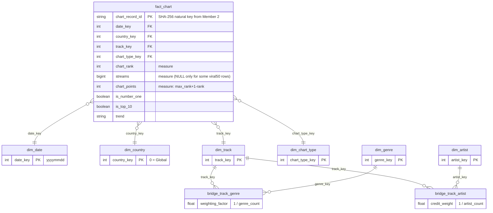

# Analytical data model (Member 3)

Member 2's Gold tables are wide and denormalised. This model turns them into a **Kimball star schema**
(one fact table, conformed dimensions, two many-to-many bridges) built by dbt in `models/marts/core/`.

## Star schema



## Tables, grain and row counts (from the real run)

| Table | Grain | Rows | Source | Notes |
|---|---|---|---|---|
| `fact_chart` | one chart entry (date x region x chart type x rank) | 50,000 | Gold `enriched_chart_data` | `streams` total = 2,387,306,735, identical to Silver (tested) |
| `dim_date` | one calendar day | 1,461 | generated (2017-01-01 .. 2020-12-31) | `date_key` = yyyymmdd = Member 2's `chart_date_id` |
| `dim_country` | one country / territory + Global | 250 | Silver `countries` | `country_key = 0` is the worldwide Global chart (`is_global = true`) |
| `dim_track` | one Spotify track | 95,406 | Silver `tracks` + chart-only tracks | 89,740 catalogue tracks + 5,666 charted tracks missing from `tracks.csv` |
| `dim_chart_type` | chart type | 2 | constants | top200 (has stream counts), viral50 (no counts) |
| `dim_genre` | genre label | 114 | Silver `track_genres` | |
| `dim_artist` | artist name (case-insensitive) | 31,650 | Silver `artist_list` + chart credits | no source artist id |
| `bridge_track_genre` | track x genre | 113,549 | Silver `track_genres` | `weighting_factor` = 1 / genre_count |
| `bridge_track_artist` | track x artist | 130,801 | Silver `artist_list` / chart credit | `credit_weight` = 1 / artist_count |

## Design decisions (and why)

1. **Surrogate integer keys** (`*_key`) for dimensions, **natural keys kept** (`track_id`, `iso_alpha3`, `chart_record_id`).
   Surrogates are small, join fast in BI tools and decouple the model from source ids. `date_key` is the exception: yyyymmdd
   is itself a stable, readable surrogate. Keys come from `row_number() over (order by natural_key)`, so they are
   deterministic for the same input but **can change when new tracks are added** - always join through the fact table, never store keys outside the warehouse.
2. **Chart-only tracks become `dim_track` rows** (`is_in_catalogue = false`, NULL audio features). Only 17.11% of chart rows match
   `tracks.csv`; dropping the rest would lose 83% of the facts. Keeping them keeps every fact row joinable, and the flag
   tells analysts where audio data exists.
3. **Global is a row in `dim_country` (key 0)**, not a NULL foreign key. Global is a *chart*, not a country, so it has no ISO code
   (`country_code = 'GLOBAL'`). Country comparisons must filter `is_global = false`.
4. **Many-to-many via bridge tables with weights.** A track has several genres/artists. Joining the bridge multiplies fact rows;
   multiplying a measure by `weighting_factor` / `credit_weight` (which sum to 1 per track) keeps totals correct.
   A test (`assert_bridge_weights_sum_to_one`) enforces this.
5. **`dim_date` is a full calendar**, not only the 25 dates present, so a BI tool can show gaps and new dates need no model change.
6. **Derived attributes are labelled.** `mood_quadrant` (valence x energy, threshold 0.5) and `tempo_band` are conventions, not Spotify fields.
7. **No SCD (history) tables.** The sources are snapshots with no changing attributes to version, so Type 1 (overwrite) is correct here.
8. **`data_volume` flag** on the trend marts: `ok` >= 5,000 entries, `limited` 1,000-4,999, `insufficient` < 1,000 (an arbitrary but documented convention).

## Lineage

```
Member 2 Parquet (Silver / Gold)
   -> sources (models/staging/_sources.yml)           read in place with DuckDB, no copy
   -> staging  stg_chart_entries | stg_tracks | stg_track_genres | stg_countries   (views, rename/select only)
   -> core     dim_* | bridge_* | fact_chart                                        (tables)
   -> analytics mart_*                                                               (tables, business questions)
   -> analyses/*.sql  (ad-hoc SQL)  and  exports/*.parquet  (for Member 5)
```

## Analytics marts

| Mart | Grain | Answers |
|---|---|---|
| `mart_country_profile` | country x chart type | regional popularity + audio profile, coverage |
| `mart_country_top_tracks` | country x rank (top 10) | what each country listens to |
| `mart_seasonal_trends` | season x chart type | seasonal pattern (see caveat below) |
| `mart_period_trends` | year-month x chart type | temporal pattern |
| `mart_genre_performance` | genre | genre popularity and sound (weighted) |
| `mart_artist_leaderboard` | artist | streams (weighted) and international reach |
| `mart_track_longevity` | track | dates, countries, best rank, #1 count |
| `mart_chart_snapshot_summary` | date x chart type | how dense the sample is per date |

## Data limits that every consumer must know

* **Audio features exist for 17.11% of chart rows** (those whose track is in `tracks.csv`). Every audio average is over that subset.
  `track_attribute_coverage` / `matched_entries` show how much.
* **The chart sample is very uneven in time.** About 99.9% of Top 200 rows come from seven dates (2017-01-01..03, 2017-02-01..02, 2018-03-01..02).
  Viral 50 has only 22 rows in total. So *Winter* = (almost) Jan-Feb 2017 and *Spring* = (almost) Mar 2018: **season is confounded with year**
  and seasonal differences cannot be separated from year differences. Summer/Autumn have too few rows to analyse.
* **`streams` are sums over sampled days**, not lifetime streams.
* **No artist id**: two artists with the same name are merged; artist country/genre cannot be filled.
* **Artist count** here (31,650 in `dim_artist`, 3,383 charted) differs slightly from Member 2's `artist_analytics` (3,363) because
  catalogue tracks use Silver's artist list while Member 2 splits the chart credit string.
